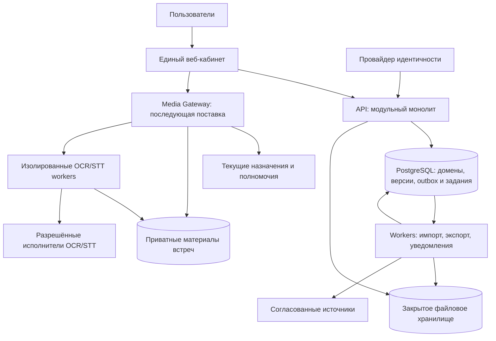

# FTTC PROF DEV HUB — техническая архитектура и план реализации

## 1. Общая концепция

FTTC PROF DEV HUB — единая платформа профессионального развития преподавателей иностранных языков. Она объединяет портфолио и индивидуальные планы развития (ИПР), встречи с руководителями, внутренние возможности ИТМО и внешние профессиональные мероприятия.

Основной пользовательский сценарий: **ИПР → подбор возможностей → планирование и подтверждение участия → портфолио → встреча 1-1 → рекомендации и черновик следующего ИПР**.

Платформа реализуется как единое веб-приложение с предметными модулями, базой данных PostgreSQL, фоновыми обработчиками и отдельным защищённым контуром материалов встреч. Такой подход позволяет последовательно расширять продукт и независимо выполнять длительные операции сбора, экспорта и распознавания.

Первая поставка — **MVP за 8 рабочих недель для пилотной эксплуатации**. Команда — 3 разработчика. Объём, условия и критерии приёмки определены в разделе 9.

Полная функциональность развивается отдельными этапами. Предварительный общий ориентир — **26–34 рабочие недели от старта**, включая MVP. Срок уточняется после обследования источников и пилота. Подключение минимум 5 внутренних и 10 внешних источников, совместные проекты, расширенные документы, аналитика и распознавание входят в последующие поставки.

## 2. Продукт и ответственность блоков

| Блок | Назначение | Владелец данных |
|---|---|---|
| 1. Портфолио и ИПР | Достижения, цели, интересы, прогресс, достижения коллег и совместные проекты | План, портфолио, проекты и их участники |
| 2. Встречи 1-1 | Записка, фиксация и анализ встречи, рекомендации, преемственность | Встречи, записки, договорённости и утверждённые рекомендации |
| 3. Возможности ИТМО | Внутренние проекты, курсы, мероприятия, гранты и стажировки | Внутренние карточки, версии и участие |
| 4. Внешние мероприятия | Конференции, семинары, вебинары и другие внешние возможности | Внешние карточки, версии, избранное и участие |

Общие функции: профиль, права, справочники, периоды, сбор, модерация, уведомления, рекомендации, аналитика и аудит.

Платформа не заменяет LMS или систему регистрации организатора. Сохранение карточки и отметка «запланировал» не означают внешней регистрации либо подтверждённого участия. Рекомендации не являются автоматическим кадровым решением.

### 2.1. Основные потоки данных

| Откуда | Куда | Передаваемые данные и результат |
|---|---|---|
| Портфолио и ИПР | Каталоги и рекомендации | Треки, цели, интересы, история и согласованные показатели прогресса для подбора возможностей |
| Внутренний и внешний каталоги | ИПР | Запланированное участие |
| Внутренний и внешний каталоги | Портфолио | Подтверждённое участие для создания или связывания достижения |
| Портфолио, ИПР и каталоги | Встречи 1-1 | Достижения, план, прогресс, участие и незавершённые действия за выбранный период |
| Встречи 1-1 | ИПР | Утверждённые рекомендации для черновика следующего периода |
| Все блоки | Уведомления и аналитика | Значимые изменения, сроки и разрешённые показатели |

Каждый вид данных имеет одного владельца. Остальные блоки получают необходимые сведения через согласованные интерфейсы. Изменение карточки мероприятия сохраняет историю и не переписывает ранее сформированные итоги встречи.

## 3. Техническая архитектура

### 3.1. Состав системы

Серверное приложение состоит из предметных модулей. Фоновые обработчики выполняют сбор данных, экспорт и уведомления, не блокируя работу кабинета. Для аудио, сканов и распознавания используется отдельный защищённый контур с собственными правами доступа.

Базовые компоненты: PostgreSQL, закрытое файловое хранилище, HTTPS и автоматизированное развёртывание. Языки, фреймворки и конкретные инфраструктурные продукты выбираются с учётом компетенций команды и среды размещения заказчика.

### 3.2. Границы модулей

| Модуль | Ответственность и ограничения |
|---|---|
| Identity & Access | Пользователи, внешние идентификаторы, роли и назначения руководителей |
| Taxonomy & Periods | Треки, компетенции, типы достижений и отчётные периоды; история справочников сохраняется |
| Portfolio & Development | ИПР, достижения, прогресс, собственные проекты и заявки; единственный владелец плана |
| Meetings | Встречи, записки, согласованные итоги, задачи, утверждение рекомендаций |
| Internal / External Catalog | Раздельные карточки, версии и участие; прямое изменение портфолио запрещено |
| Ingestion | Источники, обходы, документы, нормализация и кандидаты дублей; публикацию выполняет каталог |
| Recommendations | Классификация, подбор и объяснения; не утверждает решения руководителя |
| Notifications / Analytics | Напоминания, доставка и производные показатели; не источник первичных данных |
| Meeting Media | Приватные материалы и распознавание; без доступа общего поиска и аналитики |

Модули взаимодействуют через внутренние программные интерфейсы. Каждый модуль отвечает за изменение своих данных. Общие механизмы обеспечивают проверку прав, историю изменений, аудит и повторную обработку заданий без дублирования результатов.

### 3.3. Инфраструктура

В состав MVP входят веб-приложение, сервер приложений, фоновые обработчики, PostgreSQL, закрытое файловое хранилище, мониторинг и резервное копирование. Тестовая и рабочая среды разделены.

Длительные операции выполняются через надёжную очередь заданий. Предусмотрены повтор при временной ошибке, ограничение числа попыток, контроль состояния и ручной перезапуск. Отдельный сервер очередей подключается при необходимости или используется из существующей инфраструктуры заказчика.

Архитектура допускает увеличение числа серверов приложения и обработчиков по мере роста нагрузки. Параметры отказоустойчивости, резервного копирования и восстановления определяются по согласованным эксплуатационным требованиям.

## 4. Данные и целостность

### 4.1. Основные группы данных

| Группа | Состав | Правила хранения |
|---|---|---|
| Пользователи и права | Профили, роли, назначения руководителей | Единый профиль сотрудника; область и срок полномочий |
| Индивидуальные планы | Периоды, цели, интересы и запланированные действия | Активный план и черновики хранятся отдельно; история доступна |
| Портфолио | Достижения, треки, компетенции и подтверждения | Обязательные поля, происхождение и статус подтверждения |
| Каталоги | Внутренние возможности, внешние мероприятия, источники и история изменений | Раздельные модели карточек; публикация после проверки |
| Участие | Избранное, планы, заявления и подтверждения | Намерение участвовать отделено от факта участия |
| Встречи | Записки, договорённости, задачи, рекомендации и обратная связь | Сохраняется состав данных, на которых основаны выводы |
| Совместные проекты | Описания, заявки, роли и участники | Управление составом по решению владельца проекта |
| Служебные данные | Задания, доставка уведомлений, аудит и реестр удалений | Контроль обработки, восстановления и сроков хранения |

### 4.2. Обязательные поля

**Достижение** — тип, название, дата/период, организатор/издательство, роль преподавателя, распределение по треку; ссылка необязательна.

**Внутренняя возможность** — название, тип, подразделение, дата/период, формат, аудитория, требуемые компетенции, стоимость/условия, дедлайн, трек, ссылка, контакт, статус.

**Внешнее мероприятие** — название, организатор, дата, место, формат, аудитория, стоимость, дедлайны заявки/тезисов и регистрации, индексация, язык, ссылка, тематика, масштаб, число участников, год начала проведения; тип хранится для фильтрации.

Для полей различаются состояния: значение известно, неизвестно, неприменимо или противоречиво. Ноль участников, бесплатное участие и отсутствие индексации — фактические значения с основанием, а не замена неизвестности.

Для неприменимых полей согласуется матрица по типам мероприятий. Недостающие сведения дополняются вручную с указанием источника и автора. Неизвестное значение не считается заполненным обязательным полем. До такого решения неполная карточка остаётся на модерации. Невозможность достоверно заполнить поля должна учитываться в выборе источников и объёме публикации.

### 4.3. Единый профиль и доступ

Каждому сотруднику присваивается постоянный внутренний идентификатор. Изменение ФИО, email или подразделения не создаёт новый профиль. Вход выполняется через согласованную систему аутентификации.

Назначения руководителей поступают из утверждённого источника либо вводятся уполномоченным представителем с аудитом. Руководитель получает доступ только в пределах своей области курирования и назначенных встреч.

Права и текущая видимость проверяются сервером при каждом запросе. Закрытие достижения и деактивация пользователя прекращают выдачу соответствующих данных независимо от задержек обновления поиска. Уже скачанные пользователем файлы находятся за пределами технического отзыва.

### 4.4. Участие и портфолио

Статусы участия: «интересно», «запланировано», «участвовал», «отменено». Подтверждение учитывается отдельно: заявлено сотрудником, подтверждено, отклонено. Прошедшая дата не доказывает неявки или участия.

**Правило MVP для согласования:** преподаватель заявляет участие, назначенный руководитель либо уполномоченный модератор подтверждает по согласованному основанию. Это правило и необходимые сведения фиксируются на первой неделе. До решения неподтверждённое участие не увеличивает подтверждённый прогресс.

Подтверждение создаёт одно достижение по уникальному ключу сотрудник + источник участия + вид импорта. Недостающие обязательные поля, например роль преподавателя, запрашиваются. Ручной дубль связывается с импортом после проверки. Отзыв подтверждения вызывает пересмотр связанное достижение и прогресс с сохранением истории; повтор либо старое событие не восстанавливает отозванный факт.

### 4.5. Согласованность и история

- Изменение данных и постановка связанного фонового задания фиксируются совместно.
- Повтор обработки не создаёт повторного достижения, уведомления или черновика плана.
- Устаревшее изменение не заменяет более актуальное состояние; пропуски обработки выявляются и исправляются.
- Сводка встречи фиксирует согласованный набор данных сотрудника за период. Последующие изменения не переписывают готовый документ.
- Ручные правки защищены от автоматической перезаписи; конфликт показывается для разрешения.
- Производные показатели и поиск могут обновляться с задержкой, о которой сообщает интерфейс. Проверка доступа выполняется по текущим полномочиям.

## 5. Сбор источников и модерация

Конвейер: разрешённый доступ → сырой документ → отдельные записи → нормализация → полнота → кандидаты дублей → модерация → публикация версии → лента и напоминания.

Для каждого источника определяются владелец, адрес или канал, способ доступа, расписание обновления и ответственный за устранение ошибок. Данные доступа хранятся защищённо. Для LMS, Telegram и email заранее согласуются доступы и разрешённые способы интеграции. Коннекторы ограничивают сетевые назначения, перенаправления, размеры ответов и обработку активного содержимого.

**Полная версия:** минимум 5 внутренних и 10 согласованных внешних источников. Внешние обходятся еженедельно; период внутренних согласуется. Запись в реестре без успешного получения данных не считается подключённым источником.

**MVP:** по одному внутреннему и внешнему источнику с API/RSS либо простой стабильной HTML-структурой. Сложная авторизация, браузерная автоматизация и закрытые каналы в базовую оценку не входят. Дополнительные карточки вводятся вручную или по одному CSV-шаблону; это не засчитывается как автосбор.

При проверке дублей учитываются организатор, даты и конкретный выпуск мероприятия. Ежегодные события хранятся отдельно, даже если используют одну страницу. Повторное получение неизменённых сведений не создаёт новую карточку. Нечёткие совпадения проверяются человеком, с сохранением происхождения и возможности исправления слияния.

Повторный обход не затирает подтверждённые ручные правки: противоречие создаёт задачу с описанием различий. Новый дедлайн перестраивает расписание; перед отправкой проверяется актуальность напоминания. Подтверждённая отмена снимает карточку с рекомендаций, сохраняя историю.

На первой неделе изучаются реальные образцы обоих пилотных источников. Нагрузка модератора рассчитывается как **новые и изменённые карточки за неделю × измеренное среднее время проверки / 60** часов. Ручной поиск недостающих сведений учитывается отдельно. Для полного продукта контролируются полнота по полям, возраст очереди, время до публикации и ручной труд. Увеличение числа источников требует ресурса модерации, а не только новых парсеров.

## 6. Прогресс, компетенции и рекомендации

Для MVP используются согласованные треки и простые версионируемые правила: тип достижения, тематика, выбранный трек. Предложение сопровождается причиной; ручная правка сохраняет приоритет.

**Показатели MVP:** показывать по треку цели, планы и подтверждённые достижения. По решению методиста можно использовать бинарное покрытие «есть подходящее подтверждённое достижение за период», но не называть его уровнем мастерства. Пока критерий не утверждён, показываются факты без произвольных процентов и оценок дефицита.

В полной версии различаются следующие связи.

| Связь | Что означает | Чего не доказывает |
|---|---|---|
| Достижение → компетенция | Есть связанная деятельность | Подтверждён уровень навыка |
| Цель/интерес → компетенция | Сотрудник хочет развиваться | Навык отсутствует |
| Возможность → требуемая компетенция | Требование на входе | Возможность обучает этой компетенции |
| Возможность → развиваемая компетенция | Заявленный результат обучения, если подтверждён | Результат гарантирован каждому участнику |

Развиваемые компетенции указываются при наличии подтверждённого результата обучения. При отсутствии основания рекомендация объясняется темой/треком и не обещает закрыть дефицит. Отсутствие сведений о навыке не доказывает несоответствия требованиям курса.

Подбор сначала исключает отозванные и неприменимые карточки, затем учитывает треки, цели, интересы, сроки и согласованные признаки компетенций. Сохраняются причины, версия профиля, карточки и правил. Фильтры по трекам и персональным целям — детерминированные операции, отделённые от ранжирования.

LLM не обязателен для MVP. Позднее он может предлагать нормализацию и структуру, но не утверждает план и рекомендации. Источники и распознанный текст рассматриваются как данные: содержащиеся в них команды не исполняются. Схема вывода и ссылки на основания проверяются.

## 7. Встречи 1-1 и преемственность

### 7.1. Сценарий MVP

Руководитель выбирает сотрудника/период, открывает автоматически собранную сводку плана, достижений и участия, фиксирует согласованные договорённости и задачи, редактирует и утверждает рекомендации. Сотрудник видит согласованную часть и оставляет обратная связь.

Используется один фиксированный шаблон сводки. Для MVP предлагается печатная HTML-версия с сохранением в PDF браузером. Заказчик должен принять этот ограниченный способ экспорта в первой поставке. Серверный PDF, DOCX, редактор шаблонов и отдельный one-pager относятся к следующим этапам.

MVP принимает **структурированные согласованные итоги**: договорённость, ответственный, срок, трек, статус. Загрузка аудио/сканов, транскрипт, приватный дневник руководителя и автоматическое извлечение задач из свободных заметок в MVP не входят. Расширенные способы фиксации встречи включаются на этапе защищённой обработки материалов.

Утверждение набора один раз создаёт связанный черновик следующего периода. Текущий план не перезаписывается. Изменения уже отредактированного черновика показываются как предложения для принятия, а не затирают ручные правки.

Состояние встречи отделено от доставки рекомендаций: встреча может быть завершена со статусом передачи «ожидает обработки», «применено», «ошибка» или «требует разрешения конфликта». Ошибка доставки видна и допускает безопасный повтор.

### 7.2. Полная версия

Добавляются шаблоны, PDF/DOCX/one-pager, комментарии до встречи, история и сравнение периодов, карта задач, повторные темы, распознавание печатного и рукописного текста (OCR), расшифровка речи (STT), русский и английский, гибридный ввод и автоматическое предложение структуры.

Распознавание сохраняет ссылку на страницу, фрагмент или временной интервал, версию исполнителя и неопределённые места. Руководитель проверяет задачи, ответственных и сроки. Недостающие сведения не дополняются как факты. Ошибка распознавания не мешает ручному согласованию.

Анализ эмоционального тона является дополнительной функцией. Он не включён в обязательную оценку готовности, не влияет автоматически на рекомендации и требует отдельного продуктового и правового решения.

## 8. Доступ, защита и жизненный цикл

| Данные | Преподаватель | Назначенный руководитель | Администратор |
|---|---|---|---|
| Свой ИПР и портфолио | Управляет своим | В пределах курирования и разрешённых операций | Настройки/модерация по полномочиям |
| Достижения коллег | Только опубликованные ему | Опубликованные и разрешённые в области | Модерация с аудитом |
| Каталоги | Опубликованные карточки | Опубликованные карточки | Источники, модерация и публикация |
| Аналитическая записка | По отдельному согласованному правилу | По назначенной встрече | Шаблоны и метаданные; роль не открывает содержимое автоматически |
| Согласованные итоги и рекомендации | Своя утверждённая часть | По назначенной встрече | Разрешённые агрегаты |
| Приватные заметки, аудио, сканы, OCR/STT | Не предоставляется; исключения определяются политикой доступа | Только уполномоченный руководитель конкретной встречи | Нет автоматического доступа к содержимому |

Доступ сотрудника к аналитической записке, передача истории новому руководителю и исключительные случаи определяются отдельной политикой. До работы с реальными персональными данными (ПДн) согласуются размещение, полномочия, основания обработки и сроки хранения.

Обязательные меры MVP: HTTPS, закрытая база данных и файлы, защищённое хранение секретов, серверная проверка прав, аудит значимых операций, безопасный импорт, резервное копирование и проверка восстановления. Приватные тексты, пароли и токены не попадают в технические журналы.

Аудио, сканы, приватные заметки и результаты распознавания обрабатываются в защищённом контуре с отдельными правами. Доступ к файлам предоставляется после проверки полномочий. Общий поиск и административная аналитика не получают содержимое этих материалов.

Сроки хранения устанавливаются отдельно для исходников, распознанного текста, заметок, согласованных итогов, записок, экспортов, аудита и резервных копий. Удаление учитывает активные копии и предусмотренные политикой производные. После восстановления из резервной копии ограничения доступа и ранее выполненные удаления применяются до открытия системы пользователям.

При уходе сотрудника доступ отзывается. История не удаляется и не передаётся автоматически. Для проектов определяется новый владелец; доступ следующего руководителя к прошлым встречам предоставляется по согласованным правилам.

## 9. MVP за 2 месяца

### 9.1. Условия оценки

Результат — пилот одного подразделения. Для планирования предлагается **до 50 приглашённых пользователей и до 10 одновременно активных пользователей**. Параметры пилотной группы согласуются перед началом работ; они не ограничивают развитие платформы.

Базовый план предполагает:

1. Все 3 разработчика работают полный день; в команде есть опыт frontend, backend, БД и развёртывания.
2. Заказчик назначает владельца продукта и методиста/модератора; решения по MVP принимаются за 1–2 рабочих дня.
3. На первой неделе доступны треки, типы достижений, периоды, пилотные пользователи и назначения руководителей.
4. Есть два доступных источника. Первоначальный адаптер каждого укладывается примерно в 3–5 разработческих дней; сложность проверяется на образцах.
5. Есть готовая система аутентификации (IdP) либо согласованы приглашённые аккаунты без публичной регистрации. Создание собственного сервера идентичности не включено.
6. Доступна среда размещения и согласованы условия пилотных ПДн. Сложная инфраструктура и длительные внешние процедуры требуют отдельной оценки.
7. Интерфейс использует готовые компоненты; отдельная дизайн-система и мобильные приложения не включены.
8. Объём, импорт, подтверждение участия и минимальная встреча фиксируются к концу первой недели.

### 9.2. Состав поставки

| Область | В MVP | В следующих поставках |
|---|---|---|
| Вход и права | Один способ входа; преподаватель, руководитель, администратор; аудируемые назначения и деактивация | HR-синхронизация, сложное делегирование, несколько IdP |
| ИПР | План на период, цели, интересы, треки, следующий черновик | Сложные маршруты согласования |
| Портфолио | Ручной ввод, обязательные поля, подтверждение, правила треков и ручная правка | Произвольные форматы импорта |
| Коллеги | Лента явно опубликованных достижений и фильтр по треку | Поиск по нормализованным компетенциям, карта/облако |
| Каталоги | Раздельные карточки, обязательные поля карточек, фильтры типа/трека/даты, ручное дополнение | Расширенные фильтры и поиск |
| Источники | 1 внутренний и 1 внешний; расписание, ошибки, повтор | Расширение до минимум 5 внутренних и 10 внешних; закрытые LMS, Telegram/email |
| Модерация | Полнота, публикация, точные дубли, ручная проверка похожих записей | Развитая нечёткая дедупликация |
| Участие | Избранное, планирование, заявление/подтверждение, один импорт достижения | Автопроверка внешних реестров/сертификатов |
| Календарь | Список запланированного с датами в кабинете | Согласованный внешний формат/сервис и синхронизация |
| Рекомендации | Простые правила треков/целей/сроков и объяснение | Семантика компетенций и развитое ранжирование |
| Встречи | Сводка, структурированные согласованные итоги и задачи, утверждение, обратная связь, черновик | Свободные приватные заметки, автоматическое структурирование, OCR/STT |
| Документы | Фиксированный HTML и печать в PDF браузером | Серверный PDF, DOCX, редактор шаблонов, one-pager |
| Уведомления | Встроенные уведомления о решениях, рекомендациях и сроках; одно правило напоминаний | Внешние каналы, гибкие настройки |
| Аналитика | Счётчики достижений, планов/участия, факты покрытия, число встреч | Многолетние дашборды, системные дефициты, полная статистика мероприятий |
| Проекты | Карточки внутренних проектов как возможностей | Собственные совместные проекты, заявки и состав |
| Эксплуатация | Развёртывание, мониторинг, резервное копирование и восстановление, инструкция, проверки прав | Многозонная отказоустойчивость и резервная площадка по согласованным требованиям |

Полнота сохраняется как правило модели. MVP не обещает автоматическое извлечение каждого поля из каждого источника: часть достоверно дополняет модератор. Если значение нельзя получить, карточка остаётся на проверке либо применяется заранее согласованное изменение критерия.

### 9.3. Организация работ

Оценка рассчитана на трёх разработчиков с полной занятостью. Тестирование, интеграция, развёртывание, исправления и документация включены в срок. На эти работы и обследование предусмотрено около трети доступного времени команды.

Со стороны заказчика необходимы владелец продукта, методический эксперт и ответственный за модерацию. Команда демонстрирует результат еженедельно; изменения объёма оцениваются по влиянию на сроки. Последние две недели отведены преимущественно на проверки, пользовательскую приёмку и подготовку запуска.

### 9.4. План по неделям

| Неделя | Работа | Проверяемый результат |
|---|---|---|
| 1 | Обследование источников, правила, UX, вход, каркас и среда | Объём работ и критерии приёмки зафиксированы; вход работает; образцы двух источников проверены |
| 2 | Профиль, роли, справочники, портфолио и план | Сотрудник создаёт цель/достижение; чужие данные защищены |
| 3 | Карточки каталогов, ручной/CSV-ввод, модерация, лента коллег | Полная карточка публикуется; неполная остаётся на проверке |
| 4 | Два коннектора, расписание, происхождение, дубли и конфликты | Повтор не создаёт дубль; ручная правка сохраняется; ошибки видны |
| 5 | Планирование, подтверждение, импорт достижения, правила рекомендаций и напоминания | Работает «цель → возможность → участие → портфолио» |
| 6 | Сводка встречи, печать, согласованные итоги, утверждение, следующий черновик | Пройден весь цикл; текущий план не перезаписан |
| 7 | Заморозка функций, интеграционные проверки, права, восстановление, пользовательское тестирование | Критичные сценарии проверены; основные дефекты устранены |
| 8 | Резерв исправлений, пользовательская приёмка, обучение, документация, выпуск | Протокол MVP, ограничения и ответственные за эксплуатацию |

На четвёртой неделе уточняется прогноз завершения. Если профиль, портфолио и публикация карточек не готовы, расширение прекращается и сокращается объём работ. Последние две недели не используются для добавления крупных функций.

### 9.5. Приёмка MVP

1. Работают вход и роли. Руководитель видит назначенных сотрудников; администратор не открывает данные встреч только своей ролью.
2. Создаются план и достижение со всеми обязательными полями; предложение трека объяснимо; ручная правка сохраняется после повторной классификации.
3. Коллега видит явно опубликованную запись; после закрытия запись недоступна даже при остановленном обновлении индекса.
4. Два согласованных источника проходят первоначальный и повторный обход. Дубли, изменения и ошибки различаются; неполные карточки не публикуются по умолчанию.
5. Работают поиск, избранное и планирование. Только подтверждение по правилу создаёт одно достижение; недостающие обязательные поля запрашиваются.
6. Повтор, отзыв и задержанная доставка подтверждения не создают двойного прогресса и не восстанавливают отозванный факт.
7. Сводка периода сохраняет входные версии; печатная версия содержит те же факты, корректный русский и английский текст.
8. Сотрудник видит разрешённые итоги, обратная связь сохраняется отдельно. Утверждение и его повторная обработка создают один связанный черновик следующего периода без потери ручных изменений.
9. Напоминание соответствует актуальному сроку; перенос отменяет старое неотправленное задание. Ошибка обработки видна и допускает повтор.
10. Деактивация блокирует новые запросы. Выполнен тест восстановления с актуальными отзывами прав и удалениями, без автоматической рассылки старых уведомлений.
11. Выполнен нагрузочный прогон на согласованной выборке. Предлагаемый ориентир: время выполнения обычных запросов просмотра до 2 секунд для 95% запросов при 10 одновременно активных пользователях; импорт и экспорт исключаются. Среда и данные фиксируются до прогона. Это предложение, не уже достигнутый показатель.
12. Переданы инструкция запуска/восстановления, руководство модератора, ограничения и результаты проверок; критичные дефекты потери данных и обхода доступа закрыты.

### 9.6. Если условия не выполняются

Первое сокращение — лента коллег и необязательные визуальные показатели. Второе — дополнительные представления встречи, сохраняя фиксированную сводку и структурированные итоги. При технической неготовности одного источника допускается ручной/CSV-ввод и один автоматический источник, но поставка **явно переопределяется как пилот с сокращённой интеграцией**. Изменение числа автоматических источников требует отдельного согласования объёма первой поставки.

Изменение объёма согласуется с заказчиком на основании готовности функций и уточнённой оценки. Права, целостность импорта и восстановление не используются как резерв для новых функций. Если эти свойства не готовы, запуск с реальными данными переносится.

## 10. Разработка до полной готовности

План рассчитан на тех же 3 разработчиков. Длительности поставок последовательные; интервалы показывают неопределённость, а не наличие дополнительных команд.

| Поставка | Длительность | Ориентир от старта | Содержание и результат |
|---|---|---|---|
| P0. MVP | 8 недель | Неделя 8 | Приёмка по разделу 9.5, ограничения пилота зафиксированы |
| P1. Каталоги, источники и коллаборация | Ещё 6–8 недель | Неделя 14–16 | Подключение не менее 5 внутренних и 10 внешних источников, собственные проекты/заявки/участники, поиск по компетенциям, полный согласованный календарь, устойчивый процесс модерации |
| P2. Полные встречи и аналитика | Ещё 5–7 недель | Неделя 19–23 | Шаблоны, серверный PDF/DOCX/one-pager, комментарии до встречи, история периодов, динамика и задачи, расширенные правила прогресса/подбора и обязательные показатели |
| P3. Распознавание и защищённые материалы | Ещё 5–7 недель | Неделя 24–30 | Media Gateway, отдельные права, аудио/сканы, OCR печатного и рукописного текста, STT RU/EN, гибридный режим, структурирование, проверка человеком, сроки хранения и удаление |
| P4. Эксплуатационная приёмка | Ещё 2–4 недели | Неделя 26–34 | Нагрузка полного профиля, аудит доступа, резервное копирование и восстановление, удаления, полная пользовательская приёмка, инструкции и передача сопровождению |

Эксперимент качества OCR/STT на разрешённых образцах начинается в P1, чтобы не обнаружить непригодность исполнителя в конце проекта. Обработка реальных материалов встреч включается в P3 после готовности защищённого контура.

Оценка предполагает доступные интеграции, пригодного исполнителя распознавания и инфраструктуру без длительного отдельного согласования. Собственное распознавание, локальный GPU-контур с нуля, сложные закрытые источники и дополнительные регламентные процедуры могут вывести срок за 34 недели. В начале P1 оценивается каждый оставшийся источник: Трудоёмкость подключения зависит от интерфейса, авторизации, структуры и качества данных каждого источника. При значительном превышении срока заказчику предлагается дополнительный интеграционный ресурс либо перенос части подключений с явным изменением графика.

### 10.1. Критерии полной готовности

- Все функции согласованного полного объёма реализованы и прошли приёмку.
- Не менее 5 внутренних и 10 внешних согласованных источников реально получают, обновляют и публикуют данные; внешний обход еженедельный. Зафиксировано, что считается отдельным источником, без произвольного зачёта разделов одного сайта.
- По всем обязательным полям действует согласованная политика; обеспечены ресурсы модерации. Отчёт о неполноте не подменяет выполнение критерия.
- Полностью работают портфолио, поиск коллег по компетенциям, проекты и заявки, участие, прогресс, рекомендации и все межблоковые потоки.
- Формируются PDF/DOCX и one-pager, работают шаблоны, история и сравнение периодов; показатели имеют утверждённые формулы и версии.
- OCR печатного/рукописного текста и STT проверены на русских и английских наборах заказчика. Метрики, пороги и критичные ошибки согласованы до приёмки; одна демонстрация не считается оценкой качества.
- Проверены доступ, смена руководителя, деактивация пользователя, сроки хранения, удаление и восстановление; утверждены размещение и исполнители.
- Утверждён и пройден фактический нагрузочный профиль; установлены цели эксплуатации и поддержка; переданы инструкции.

Анализ эмоций, мобильные приложения, многозонная отказоустойчивость и дополнительные сторонние интеграции согласуются отдельно. Если заказчик делает их обязательными, объём работ и оценка меняются.

## 11. Распределение функций по поставкам

«Базово» означает ограниченное выполнение для пилота. Полная приёмка относится к указанной следующей поставке.

| Функция | MVP | Полное выполнение |
|---|---|---|
| Единый профиль, кабинет, роли | Да, пилотные назначения | P1–P4: полный согласованный режим управления пользователями и правами и эксплуатационные проверки |
| Достижения, типы, атрибуты | Да; импорт пилотного участия | P1: все подключённые возможности |
| Автораспределение и корректировка | Простые правила | P1–P2: расширение и оценка качества |
| Коллеги, фильтры, компетенции | Лента и трек | P1: нормализованные компетенции и согласованная визуализация |
| Проекты и присоединение | Нет | P1 |
| Администрирование Блока 1 | Базово | P1–P2 |
| Агрегация, периоды и прошлые цели | Данные пилота | P2: сравнение и полная история |
| Записка, PDF/DOCX, one-pager, шаблоны | Фиксированная сводка и печать | P2 |
| Текст, OCR, STT, гибридный ввод | Только структурированные итоги | P2–P3: полный ввод и распознавание |
| Анализ, динамика, повторные темы | Факты и задачи | P2–P3 |
| Рекомендации, обратная связь и следующий ИПР | Основной путь | P2: расширение и преемственность |
| Уведомления и настройки встреч | Встроенные уведомления и фиксированные правила | P2: периодичность и согласованные каналы |
| Защита записей, сроки, RU/EN | Защита данных MVP; исходные материалы не загружаются | P3–P4 |
| Источники и карточки ИТМО | 1 источник, схема и модерация | P1: минимум 5 источников и согласованное покрытие каналов |
| Дубли, обновления, подбор и лента | Базово | P1–P2 |
| Администрирование и критерии Блока 3 | Для пилотной группы | P1–P4 |
| Внешние источники и поля | 1 источник, схема и модерация | P1: минимум 10 и политика полноты |
| Проверка, еженедельный обход и аналитика | Обход и базовая проверка | P1–P2: полный набор операций и статистики |
| Избранное, календарь, напоминания | Избранное, даты, встроенные уведомления | P1–P2: согласованный календарь и полный режим |
| Интеграции и сквозной сценарий | Основной цикл с ограничениями | P1–P4: все потоки и режимы |

## 12. Решения заказчика и зависимости

Вопросы решаются к моменту влияния на соответствующую функцию; они не требуют останавливать всю разработку. Допущения фиксируются письменно и не выдаются за подтверждённые требования.

| Срок решения | Что требуется | Владелец | Последствие отсутствия |
|---|---|---|---|
| Неделя 1 | Объём первой поставки и состав пилотной группы | Владелец продукта | Нельзя зафиксировать ожидаемую приёмку |
| Неделя 1 | Треки, типы, периоды, видимость, подтверждение участия | Методист и владелец продукта | Формы и факты возможны; прогресс/подтверждённый импорт не принимаются |
| До интеграции входа | IdP или приглашённые аккаунты, источник назначений и отзыв | IT / ответственный за управление пользователями | Проверки на синтетических пользователях |
| До коннекторов | Два источника, доступы, образцы и допустимый способ получения | Владельцы источников | Ручной/CSV-ввод; пересмотр объёма интеграций |
| До публикации | Применимость полей, полнота, основания дополнения, модератор | Методист и владелец продукта | Строгая модерация; неполные не публикуются |
| До реальных встреч | Доступ к записке/итогам, размещение, основания и сроки | Владелец продукта, ответственный за ПДн/ИБ | Демонстрация на синтетических данных |
| До P1 | Полный реестр минимум 5 внутренних и 10 внешних источников, приоритет и модерация | Владелец продукта и источников | Нельзя фиксировать срок полной версии |
| До P2 | Формулы, шаблоны, календарь, каналы и периодичность уведомлений | Методист и владелец продукта | Только согласованные факты без произвольных оценок |
| До P3 | Исполнитель OCR/STT, ограничения передачи, RU/EN наборы, качество, все сроки хранения | IT, ИБ, ответственный за ПДн, методист | Распознавание реальных материалов не включается |
| До P4 | Пользователи, пики, объёмы, целевые доступность, время восстановления и допустимая потеря данных, поддержка и бюджет | Владелец продукта и эксплуатация | Нельзя заявить эксплуатационную готовность |

Журнал решений содержит вопрос, выбранное правило, владельца, дату, влияние на объём работ и критерий проверки. После согласования MVP изменения оцениваются по сроку и ресурсу.

## 13. Эксплуатация и сопровождение

MVP контролирует ошибки API, задания, последний успешный обход, уведомления и резервные копии. Логи содержат идентификаторы операций и диагностику без приватных текстов, токенов и секретных URL. Доступ к аудиту отделяется от обычных логов.

Полная версия дополнительно контролирует очереди модерации, задержки проекций, удаления, длительность/ошибки OCR/STT и стоимость обработки. Импорт, экспорт и распознавание имеют раздельные лимиты; длительное задание не блокирует кабинет. Интерфейс показывает состояние и результат обработки.

Изменения приложения и структуры данных проверяются в тестовой среде, включая совместимость фоновых обработчиков и процедуру восстановления работоспособности. Перед открытием восстановленной среды блокируются внешние отправки, сверяются задания и применяются актуальные удаления/отзывы. Реальные материалы встреч не копируются в нижестоящие среды без разрешённого процесса.

Рекомендуемый набор проверок: доменные правила, транзакционные импорты и повторы, права на каждый тип объекта/файла, контракты и тестовые примеры источников, сквозные сценарии, миграции и восстановление. Для полной версии добавляются RU/EN выборки OCR/STT, длительные загрузки, восстановление удалений и нагрузка по реальному профилю.

Бюджет эксплуатации включает инфраструктуру, хранение/резервные копии, сопровождение источников после смены разметки, модерацию, поддержку и OCR/STT/LLM при использовании. Без объёмов и исполнителей числовой бюджет не определяется. После пилота оцениваются затраты на пользователя, карточку и минуту распознавания.

## 14. Риски и меры

| Риск | Влияние | Мера |
|---|---|---|
| Разработчики выполняют также тестирование и эксплуатационные работы | Меньше времени на разработку функций | Резерв времени на проверки, взаимная проверка и согласованный объём MVP |
| Расширение объёма первой поставки | Сдвиг сроков | Согласованный состав MVP и отдельная оценка изменений |
| Сложные/закрытые источники | Сдвиг автосбора | Образцы в неделю 1, индивидуальная оценка адаптеров |
| Низкая полнота полей | Очередь модерации и мало публикаций | Матрица применимости, достоверное дополнение, измерение труда |
| Неясные правила прогресса | Недостоверные оценки | Методический владелец, версии правил, факты до согласования |
| Низкое качество рукописного OCR | Неверные задачи и сроки | Ранний эксперимент, критерии качества и проверка человеком |
| Утечка через заметки, экспорт, AI | Нарушение доступа | Классификация по содержимому, шлюз, изоляция материалов встреч, минимизация |
| Повторы и конкурирующие правки | Дубли и потеря изменений | Защита от дублей, контроль одновременных правок и сверка изменений |
